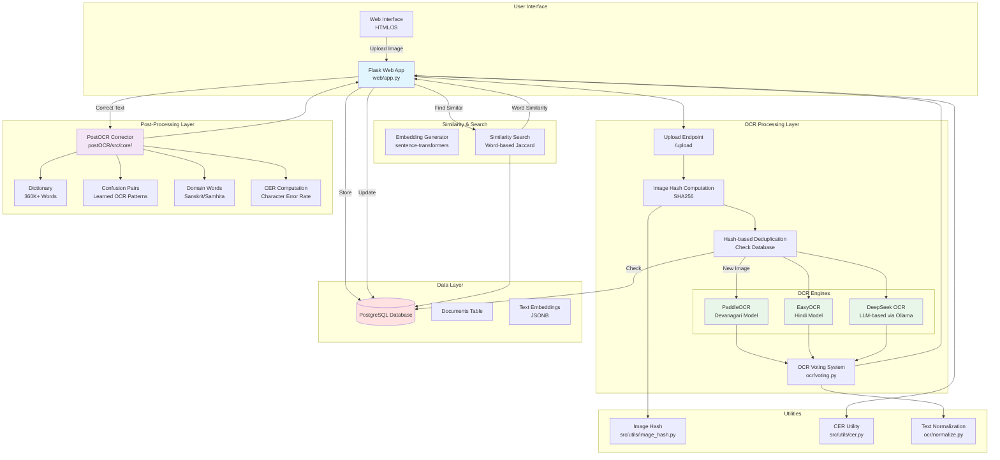

# MultiOCR Architecture Diagram

## System Overview

MultiOCR is a multi-model Optical Character Recognition system with hash-based document deduplication, version control, and human-in-the-loop post-correction for Devanagari manuscripts.

## Architecture Diagram



## Data Flow

### 1. Upload & Deduplication Flow
```
User Upload → Flask App → Compute SHA256 Hash → Check Database
    ↓
    ├─ Duplicate Found → Return Cached Results
    └─ New Image → Proceed to OCR
```

### 2. OCR Processing Flow
```
Image → OCR Processing
    ↓
Parallel OCR Execution:
    ├─ PaddleOCR (Devanagari)
    ├─ EasyOCR (Hindi)
    └─ DeepSeek OCR (LLM-based)
    ↓
Voting System → Confidence-based Selection
    ↓
Store in Database (v1: OCR output)
```

### 3. Post-Correction Flow
```
OCR Text → PostOCR Corrector
    ↓
Dictionary Lookup (360K+ words)
    ↓
Confusion Pair Matching (Learned patterns)
    ↓
Domain Word Check (Sanskrit/Samhita)
    ↓
Auto-Correction → Compute CER
    ↓
Store in Database (v2: Corrected text)
```

### 4. Similarity Search Flow
```
Current Document → Word Tokenization
    ↓
Compare with Database Documents
    ↓
Jaccard Similarity (Word overlap)
    ↓
Return Similar Documents
```

## Component Descriptions

### Web Layer (`web/`)
- **app.py**: Flask application with REST endpoints
- **Routes**:
  - `/upload`: Handle image uploads with hash-based deduplication
  - `/process`: Execute OCR with multiple engines
  - `/correct`: Apply PostOCR corrections
  - `/review`: Human-in-the-loop correction interface

### OCR Layer (`ocr/`)
- **paddle_ocr.py**: PaddleOCR engine for Devanagari text
- **easy_ocr.py**: EasyOCR引擎 for Hindi text
- **deepseek_ocr.py**: DeepSeek LLM-based OCR via Ollama
- **voting.py**: Confidence-based voting between OCR results
- **normalize.py**: Text normalization utilities

### Post-OCR Layer (`postOCR/`)
- **corrector.py**: Main correction engine
- **dictionary.py**: Trie-based dictionary with 360K+ words
- **confusion_pairs.py**: Learned OCR error patterns
- **edit_distance.py**: Edit distance algorithms
- **lcs.py**: Longest common subsequence for similarity

### Database Layer (`src/database/`)
- **setup_database.py**: Database initialization with schema
- **db.py**: Database connection utilities
- **migrate_db.py**: Database migration scripts

### Similarity Layer (`similarity/`)
- **embeddings.py**: Sentence-transformers for text embeddings
- **search.py**: Word-based similarity search using Jaccard index

### Utilities (`src/utils/`)
- **image_hash.py**: SHA256 image hashing for deduplication
- **cer.py**: Character Error Rate computation
- **build_vocab.py**: Vocabulary building utilities

## Database Schema

### Documents Table
| Column | Type | Description |
|--------|------|-------------|
| id | SERIAL | Primary key |
| image_path | TEXT | Path to uploaded image |
| image_hash | VARCHAR(64) | SHA256 hash for deduplication |
| ocr_text | TEXT | Raw OCR output (v1) |
| corrected_text | TEXT | Human-corrected text (v2) |
| cer | FLOAT | Character Error Rate |
| parent_id | INTEGER | Parent document ID for version tracking |
| version | INTEGER | Document version (1=OCR, 2=Corrected) |
| status | VARCHAR | pending/ocr/corrected/reviewed |
| text_embedding | JSONB | Text embedding vector |
| created_at | TIMESTAMP | Creation timestamp |
| updated_at | TIMESTAMP | Last update timestamp |

### Indexes
- `idx_image_hash`: Fast hash-based lookups
- `idx_parent_id`: Version tracking queries
- `idx_status`: Status filtering
- `idx_created_at`: Time-based sorting

## Key Features

### 1. Hash-Based Deduplication
- SHA256 hash computed for each uploaded image
- Duplicate detection prevents re-processing
- Instant retrieval of cached results

### 2. Multi-Model OCR
- Three OCR engines run in parallel
- Confidence-based voting selects best results

### 3. Version Control
- v1: Raw OCR output
- v2: Human-corrected text
- Parent-child relationships track document evolution

### 4. Post-OCR Correction
- 360K+ word dictionary with trie structure
- Learned confusion pairs from OCR errors
- Domain-specific vocabulary (Sanskrit, Samhita)
- Auto-correction with confidence thresholds

### 5. Accuracy Tracking
- Character Error Rate (CER) quantifies quality
- Compares OCR vs corrected text
- Tracks improvement over versions

### 6. Similarity Search
- Word-based Jaccard similarity
- Helps find similar documents for reference
- Supports human-in-the-loop correction

## Technology Stack

- **Backend**: Flask (Python)
- **Database**: PostgreSQL
- **OCR Engines**: PaddleOCR, EasyOCR, DeepSeek OCR
- **ML Models**: sentence-transformers (embeddings)
- **Frontend**: HTML, JavaScript, CSS
- **LLM**: Ollama with DeepSeek OCR model
