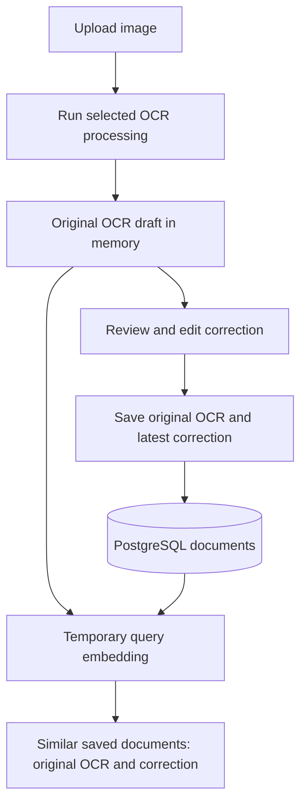

# MultiOCR architecture

## Components

MultiOCR uses a FastAPI web server, Jinja templates, PostgreSQL, local OCR engines, an Ollama-backed DeepSeek engine, and SentenceTransformer text embeddings.

## Ownership of text

- `ocr_text` is the original OCR for a saved document.
- `corrected_text` is its latest saved correction.
- Later edits preserve `ocr_text` and replace only the correction.
- Re-running OCR starts a new draft. Saving it creates a separate document.
- Previous correction edits are not archived. Save information is displayed as Original OCR, Correction saved, and Last edited.

## Routes

| Route | Behavior |
| --- | --- |
| `POST /upload` | Save an image and initialize an empty draft |
| `POST /process` | Run OCR using `filepath` and `mode`; keep results in memory |
| `POST /similar-documents` | Search saved references using raw OCR |
| `GET /review/new` | Review the active unsaved draft |
| `POST /review/new` | Create a row containing both texts and embeddings |
| `GET /review/{doc_id}` | Load original OCR, correction, edit time, and references |
| `POST /review/{doc_id}` | Update the latest manual correction, CER, vector, and edit time |
| `POST /correct` | Generate corrections; persist them when a saved document ID is supplied |
| `POST /detect-errors` | Return dictionary-based error suggestions |
| `POST /add-to-dictionary` | Record a learned spelling/confusion pair |
| `POST /reprocess/{doc_id}` | Return the saved image location for another OCR run |
| `GET /api/session-data` | Restore the active draft and save information |
| `POST /api/clear-session` | Clear active draft state |

## Search

`similarity/search.py` embeds the current original OCR and compares it to `ocr_embedding` and `text_embedding` for each candidate. The stronger valid cosine score determines the match. Exact ties prefer original OCR. If neither vector can be compared, word overlap is used against both texts.

The current saved document is excluded. Candidates are the latest 100 rows, ranked by similarity with document ID as the tie breaker. The default threshold is 0.3. Home references load independently of OCR rendering, with cancellation of stale requests, retry on failure, and three-at-a-time expansion. Review pages show up to five matches.

## Persistence

The `documents` table contains `id`, `image_path`, `ocr_text`, `corrected_text`, `cer`, `status`, `ocr_embedding`, `text_embedding`, `created_at`, and `updated_at`.

New saves compute both vectors. Manual edits and saved automatic corrections recompute only the correction vector. If embedding generation fails, the text can still be saved and the affected vector is null. Search can fall back to text overlap.

`database/migrate_db.py` upgrades existing schemas transactionally and removes unused legacy metadata without deleting document rows. `database/backfill_embeddings.py` rebuilds vectors from their own texts and guards against concurrent source changes.

## Code boundaries

- `web/app.py`: routes, draft state, persistence orchestration.
- `web/static/document_status.js`: common save-information rendering.
- `web/static/similar_documents.js`: reference cards and loading state.
- `ocr/`: engines, voting, benchmarks, text normalization.
- `correction/` and `postocr_integration.py`: suggestions and learned corrections.
- `similarity/`: encoding, cosine comparison, word overlap.
- `database/`: connections, schema, migration, and vector maintenance.

Use root-package imports such as `from database.db import get_db`.

## Runtime limits

Draft state currently uses a shared in-memory dictionary. It is lost on process restart and does not isolate different users. Saved text and embeddings live in PostgreSQL; images are stored in `uploads/`.
